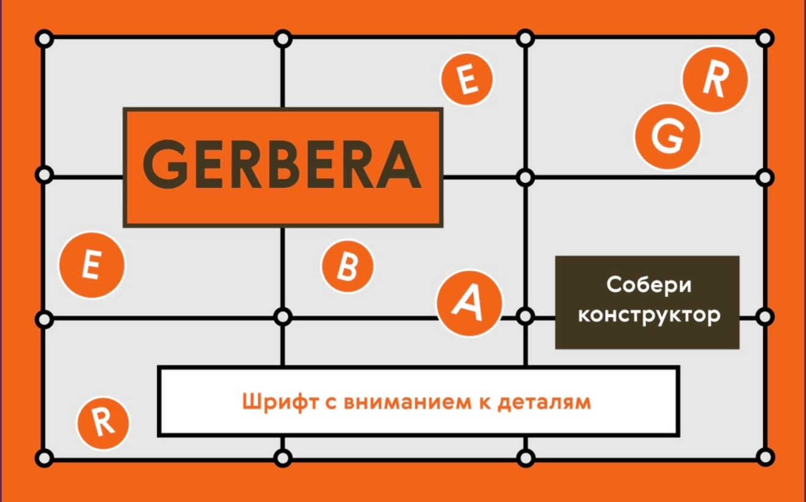

# [Gerbera]

[«GERBERA» это шрифт как точный конструктор, где буквы разложены по ячейкам и связаны визуальными узлами. Сайт показывает эту сборку вблизи и превращает знакомство со шрифтом в разглядывание точного механизма.]

## Ссылка на сайт

[https://github.com/kassssssars-create/GERBERA]

## Скриншот

## Автор

[Арсения Касаткина, БП26Д307]

## Что я научился(ась) делать

- [Научилась переносить дизайн-макет в HTML и CSS, продумывать структуру страницы и делить её на отдельные тематические блоки; Разобралась, как создавать сетку из прямоугольников, выравнивать элементы и располагать их с помощью Flexbox; Научилась работать с геометрическими фигурами, линиями и декоративными точками на пересечениях прямоугольников, чтобы повторить оформление макета; Попробовала работать с крупной типографикой: размещать большие буквы, заголовки и текстовые блоки, сочетать разные размеры шрифта и создавать наложение текста на графические элементы. Сначала было сложно правильно расположить текст и добиться нужного эффекта, но в итоге я справилась; Научилась внимательнее проверять результат в браузере и исправлять ошибки в расположении элементов, если они не совпадали с макетом. ]
- [Было сложно работать с наложением текста на другие элементы и правильно подбирать его расположение]
- [Научилась подбирать размеры, отступы и расположение элементов, чтобы сайт соответствовал моему макету.]

## Использование ИИ

### Инструменты

| Инструмент | Для чего использовал(а) |                   Уровень помощи |
| ---------- | ----------------------- | -------------- |
| [ChatGPT]        | [ Помог разобраться с расположением
                    элементов, сеткой из прямоугольников 
                    и декоративными точками на 
                    пересечениях линий]                   | [2]   |
| [DeepSeek] | [Объяснил разницу между flex 
              и grid и помог разобраться, как 
            расположить блоки в виде таблицы]              | [1]          |

### Записи о запросах

#### Запись №1 · [21.10.2026]

- **Что я хотел(а) сделать:** [расположить текстовые и графические блоки на странице так, чтобы они образовывали ровную композицию, как в моём макете. ]
- **Что я спросил(а):** [ «Как с помощью CSS расположить несколько блоков в виде таблицы, чтобы у них были ровные границы и одинаковые отступы?»]
- **Что ответил ИИ:** [ объяснил, как работает CSS Grid, как задавать количество столбцов и строк, а также чем grid отличается от flex. Рассказал, что grid удобнее для сложной сетки, а flex лучше сейчас использовать мне, раз я только начинаю.]
- **Что я изменил(а) сам(а):** [Изучила работу flex и дальше пробовала писать код и настраивать свои значения]
- **Как я понял(а), что это работает:** [ проверила страницу в браузере и убедилась, что блоки выстраиваются в нужном порядке и образуют общую композицию.]

#### Запись №1 · [21.10.2026]

- **Что я хотел(а) сделать:** [добавить маленькие круглые точки на пересечениях линий прямоугольной сетки, как на макете.]
- **Что я спросил(а):** [ «Как сделать круглые точки поверх линий сетки с помощью HTML и CSS?»]
- **Что ответил ИИ:** [подсказал использовать небольшие элементы с border-radius: 50% и позиционирование через position: absolute. Объяснил, как разместить их поверх линий с помощью position: relative у родительского блока. ]
- **Что я изменил(а) сам(а):** [ подобрала размер точек, цвет обводки и расположение, чтобы они совпадали с пересечениями линий в моём макете.]
- **Как я понял(а), что это работает:** [посмотрела результат в браузере и проверила, что точки находятся на пересечениях и не закрывают сами линии. ]

### Выводы

[ИИ помог мне разобраться с некоторыми свойствами CSS и понять, как лучше организовать блоки на странице. Особенно полезным было объяснение разницы между flex и grid, потому что сначала было сложно выбрать подходящий способ расположения элементов. Также я узнала, как с помощью позиционирования добавлять декоративные детали поверх сетки. Не весь предложенный код можно было сразу использовать без изменений, поэтому мне приходилось подстраивать его под классы и размеры моих элементов. В итоге я лучше поняла, как устроена вёрстка сайта, и смогла самостоятельно настроить многие детали макета.]
